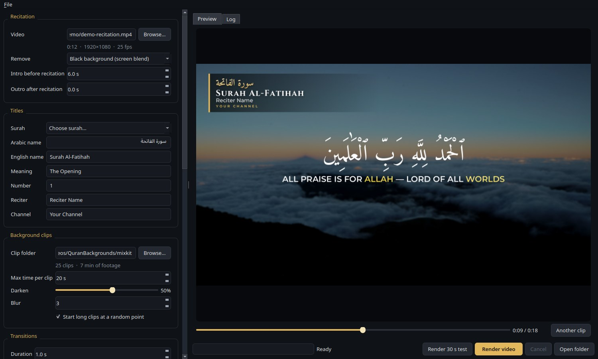
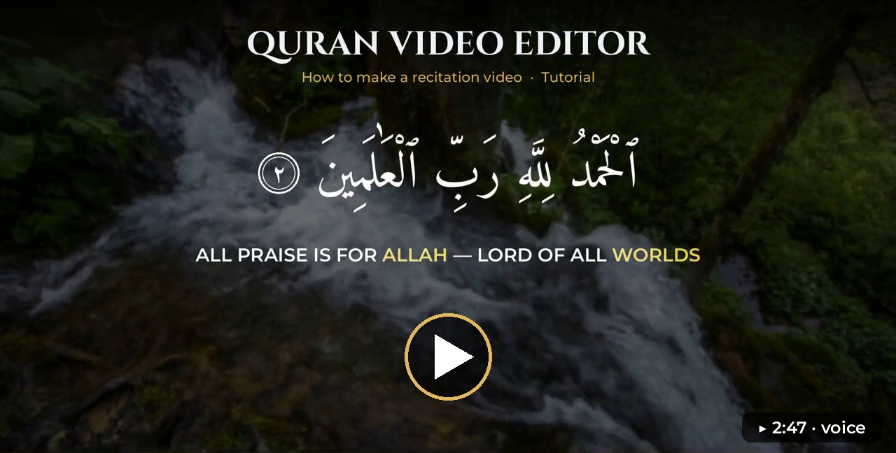
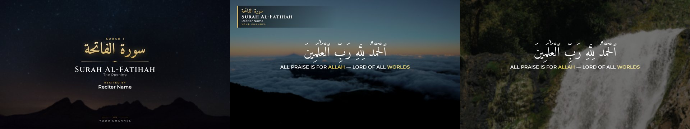
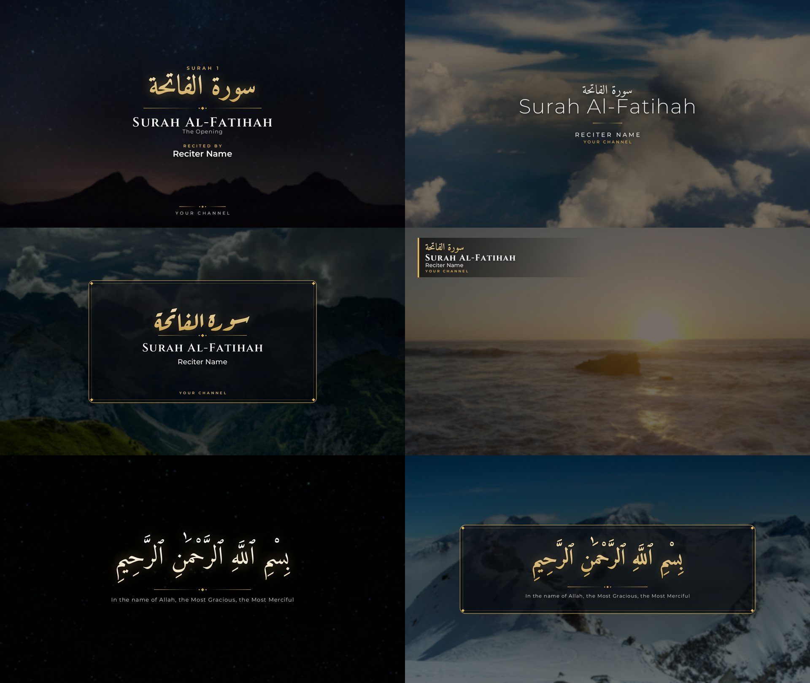

<div align="center">

# Quran Video Editor

**Turn a Quran recitation video into a finished, beautiful video — on any laptop.**

Background clips with smooth transitions · the recitation layer keyed on top · elegant Arabic title cards ·
1080p 30 fps · Windows, Linux and macOS

[](https://github.com/devgalib/quran-video-editor/actions/workflows/ci.yml)
[](https://github.com/devgalib/quran-video-editor/actions/workflows/codeql.yml)
[](https://github.com/devgalib/quran-video-editor/releases)
[](LICENSE)




</div>

## Video tutorial

<p align="center">
  <a href="https://devgalib.github.io/quran-video-editor/"></a><br>
  <sub>A narrated, captioned walk-through: install, choose a recitation, titles, background clips, transitions,
  text cards, preview and render — <a href="https://devgalib.github.io/quran-video-editor/">watch it in your browser</a> or <a href="docs/tutorial.mp4">download it</a> (2:49, 8 MB)</sub>
</p>

## Why

Recitation videos with a black (or green) background are everywhere. Making them look good usually
means a heavy video editor, a strong GPU and a lot of manual work per video. This tool does the whole
job from a few settings, and it is light enough for an 8 GB laptop without a graphics card:

| | |
|---|---|
| **Background clips** | Picks clips from your folder, never the same one twice in a row, with 16 smooth transition types |
| **Recitation layer** | Removes a black background with a screen blend (keeps the soft edges of Arabic letters) or a green screen with a chroma key |
| **Title cards** | Surah name in Arabic and English, reciter, channel, and Bismillah cards, with fade-and-rise animation |
| **Fast and light** | ~2× real time on a 4-thread laptop CPU, under 1 GB of RAM, low CPU priority so the laptop stays usable |
| **Resumable** | Stop a render at any time; it continues from where it stopped |
| **Batch** | Render hundreds of videos from one file |
| **AI-ready** | An MCP server lets Claude (or any MCP client) make videos for you |

<p align="center"></p>

## Install

**Download the app** for Windows, Linux or macOS from the
[latest release](https://github.com/devgalib/quran-video-editor/releases/latest), unzip it, and install
FFmpeg once:

| Windows | Linux | macOS |
|---|---|---|
| `winget install Gyan.FFmpeg` | `sudo apt install ffmpeg` or `sudo dnf install ffmpeg` | `brew install ffmpeg` |

**Or run from source** (Python 3.10+ and FFmpeg 6+):

```bash
git clone https://github.com/devgalib/quran-video-editor.git
cd quran-video-editor
./start.sh          # Windows: start.bat
```

The start script creates a virtual environment, installs the dependencies and opens the app.
To install it as a package instead: `pip install ".[all]"`, then run `qve gui`.

## Make a video

1. **Recitation:** choose the recitation video. Pick *Black background* or *Green screen*.
2. **Titles:** choose the surah from the list (fills the Arabic name, English name and meaning), then
   type the reciter and your channel name.
3. **Background clips:** choose a folder of clips. Nature footage works well; free sources include
   [Mixkit](https://mixkit.co/free-stock-video/nature/), [Pexels](https://www.pexels.com/videos/) and
   [Pixabay](https://pixabay.com/videos/) (check each site's licence).
4. **Text cards:** add cards and drag the preview slider to see them. Use the intro for the title
   card. If the recitation has no Bismillah, add a `bismillah` card before it starts.
5. Click **Render 30 s test** to check, then **Render video**.

### Card templates

<p align="center"></p>

| `royal` | `minimal` |
|---|---|
| `frame` | `corner` |
| `bismillah` | `bismillah_frame` |

Every card has an accent colour, a shade behind the text, a fade time and an animation.

## Command line

```bash
qve render project.json                 # one video, or every job in a batch file
qve render project.json --seconds 30    # quick test of the first 30 seconds
qve render batch.json --only 3 7        # only jobs 3 and 7
qve cards project.json --out preview/   # export the cards as PNG
qve scan ~/Videos/clips                 # read and cache clip lengths (do this once for big folders)
qve encoders                            # which GPU encoders work on this machine
qve gui                                 # the desktop app
qve mcp                                 # the MCP server
```

Without installing the package, use `python -m qve` instead of `qve`.

### Project files

A project is a JSON file; the desktop app saves the same format. See
[examples/project.json](examples/project.json) and [examples/batch.json](examples/batch.json)
(many videos sharing `defaults`). Every setting and its default is in [qve/config.py](qve/config.py).

| Setting | Meaning |
|---|---|
| `quran_video` | The recitation video |
| `output` | Output path; `{surah_en}`, `{reciter}`, … are filled from `meta` |
| `meta` | `surah_ar`, `surah_en`, `surah_meaning`, `surah_number`, `reciter`, `channel` |
| `intro_seconds` / `outro_seconds` | Background and cards before / after the recitation |
| `quran_layer.key` | `screen` for black backgrounds, `chromakey` for green screen |
| `backgrounds.folder` | Folder of clips (searched recursively) |
| `backgrounds.max_clip_seconds` | Longest time one clip stays on screen |
| `backgrounds.dim` / `blur` | Darken / blur the clips so the text stays readable |
| `backgrounds.seed` | Set a number to get the same clip order every time |
| `transitions.types` | Any FFmpeg `xfade` names: `fade`, `dissolve`, `smoothleft`, `circleopen`, `fadeblack`, … |
| `cards[]` | `template`, `start` (seconds; negative counts from the end), `duration`, `fade`, `animation` (`rise`/`fade`), `fields` (override `meta`), `options` (`accent`, `backdrop`, `position`) |
| `video.encoder` | `libx264` (CPU), or `h264_nvenc` / `h264_qsv` / `h264_amf` for NVIDIA / Intel / AMD GPUs |
| `video.threads` | CPU threads. 4 keeps a laptop cool; more is faster and hotter |

## Let Claude make videos (MCP)

`qve mcp` is a [Model Context Protocol](https://modelcontextprotocol.io) server with these tools:
`find_surah`, `scan_clips`, `inspect_video`, `list_templates`, `default_project`, `preview_frame`
(returns an image), `save_project`, `start_render`, `render_status` and `cancel_render`.
Renders run in the background; `start_render` returns at once.

Add it to Claude Code from the project folder:

```bash
claude mcp add qve -e PYTHONPATH=$PWD -- $PWD/.venv/bin/python -m qve mcp
```

Then ask, for example: *"Make a video of Surah Al-Mulk from ~/Downloads/mulk.mp4 with the clips in
~/Videos/backgrounds, reciter Mishary Alafasy, and show me a preview first."*

## Troubleshooting

| Problem | Fix |
|---|---|
| `ffmpeg not found` | Install FFmpeg (see above), put it in a `bin` folder next to the app, or set `QVE_FFMPEG_DIR` |
| Arabic letters look disconnected | Pillow is missing libraqm. Linux: install `libraqm`/`libfribidi`. Windows from source: put `fribidi-0.dll` next to `python.exe` |
| The laptop gets hot | Lower **CPU threads** to 2–3, or use a GPU encoder |
| Text is hard to read on bright clips | Raise **Darken** and add a little **Blur** |
| A render stopped | Start it again; it continues from the last finished part |

## How it works

FFmpeg does all the video work. The timeline is split into chunks of a few clips, because FFmpeg
opens every input at once and 50 open clips would need 3.5 GB of RAM; chunks are cut where one
clip is on screen and joined without re-encoding, so the joins are invisible. Details:
[docs/ARCHITECTURE.md](docs/ARCHITECTURE.md).

## Contributing

Contributions are welcome — see [CONTRIBUTING.md](CONTRIBUTING.md). Please follow the
[Code of Conduct](CODE_OF_CONDUCT.md), and report security problems as described in
[SECURITY.md](SECURITY.md).

## License

[MIT](LICENSE). The bundled fonts — [Amiri](https://github.com/aliftype/amiri),
[Aref Ruqaa](https://github.com/alif-type/aref-ruqaa), [Cinzel](https://github.com/NDISCOVER/Cinzel)
and [Montserrat](https://github.com/JulietaUla/Montserrat) — are under the SIL Open Font License
(see `qve/fonts/OFL-*.txt`). FFmpeg is a separate program with its own licence and is not included.

The recitation videos and background clips you use are not part of this project; make sure you are
allowed to use them. The example screenshots use background footage from
[Mixkit](https://mixkit.co) (Mixkit Stock Video Free License).
